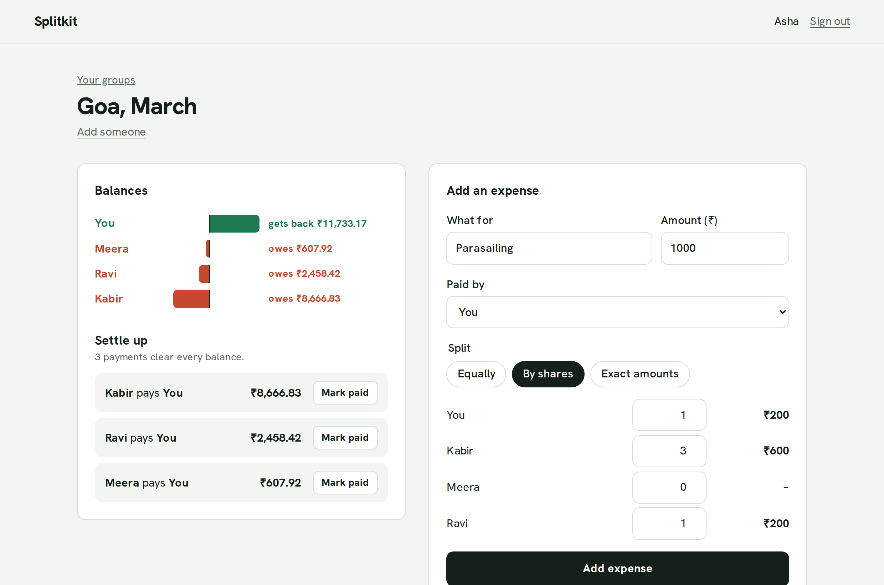

# Splitkit

Track shared expenses in a group (a trip, a flat, a dinner), see who owes whom, and settle up in as
few payments as possible.



**Stack:** Python · FastAPI · SQLAlchemy · PostgreSQL · Next.js + TypeScript · Docker · GitHub Actions

## The interesting parts

### 1. Money is integers, and splits always add up

Every amount is stored as integer paise. Floats can't hold money: `0.1 + 0.2` is not `0.3`, and a
ledger that drifts by a paisa per expense eventually stops balancing.

Integers bring their own problem: ₹100 split three ways is 3333.33 paise each, which doesn't
exist. [`api/app/money.py`](api/app/money.py) handles it with the **largest-remainder method**:
everyone gets the rounded-down share, and the leftover paise go to whoever lost the most to
rounding. ₹100 three ways becomes 3334 + 3333 + 3333, and ₹999.99 split 50:30:20 becomes
499.99 + 300.00 + 200.00. The parts always sum to the total, exactly.

Splits can be equal, by shares (2:1:1, or percentages), or exact amounts that must add up.

### 2. Settling up in the fewest payments

Given everyone's balance, who should pay whom? The common approach is greedy: the biggest debtor
pays the biggest creditor, repeat. It never needs more than *n − 1* payments, but it isn't optimal:

```text
balances:  A +₹8   B −₹8   C −₹5   D −₹7   E +₹12
greedy:    B→E ₹8, D→E ₹4, D→A ₹3, C→A ₹5        4 payments
optimal:   B→A ₹8, D→E ₹7, C→E ₹5                3 payments
```

Greedy starts with the biggest numbers and never notices that A and B cancel out exactly. The true
minimum is *n* minus the largest number of groups that each sum to zero, because a group of *k*
people who net to zero can always settle among themselves in *k − 1* payments. Finding that is
NP-hard in general, so Splitkit searches all subsets exactly for groups of up to 12 people with a
balance (about 50,000 steps, instant) and falls back to greedy above that.

### 3. Retried requests never create duplicate expenses

The "Add expense" form sends a client-generated id with each submission. If the request is sent
twice (a double click, or a retry on a flaky network) the server records it once and answers the
copy with the existing result. Two copies arriving at the same instant can both pass the
"already recorded?" check, so a database unique constraint makes the final decision.

## Testing

**41 tests**: 20 API tests (pytest, against a real PostgreSQL), 4 front-end tests, and 17 tests of
the money core in [`api/tests/test_money.py`](api/tests/test_money.py). Seven of those are
property-based: [Hypothesis](https://hypothesis.readthedocs.io/) generates thousands of random
groups and expenses and checks rules that must hold for every one of them:

- every split sums to exactly the expense amount, and equal splits differ by at most one paisa
- someone with more shares never pays less
- a group's balances always sum to zero
- the suggested payments clear every balance, never need more payments than greedy, and nobody
  is asked to both pay and be paid

Each safeguard was then removed on purpose to check a test catches it:

| Removed | Caught by |
|---|---|
| exact settle-up search (greedy only) | the 5-person case above: 4 payments instead of 3 |
| largest-remainder rounding (leftover to one person) | property: every share within one paisa of exact |
| unique-constraint recovery on retries | 16 identical requests released at once, 5 rounds: duplicates |
| one term of the SQL balance query | random 40-step history: list page and group page disagree |

The group list computes your balance in a single SQL query; the group page computes it in Python.
A test replays a random history of expenses, payments and deletions and checks both always agree.

## Run it

**With Docker:**

```bash
docker compose up --build
docker compose exec api python -m app.seed     # demo group; sign in as demo@splitkit.dev / splitkit-demo
```

Open http://localhost:8081.

**For development** ([uv](https://docs.astral.sh/uv/), Node 22+, PostgreSQL):

```bash
cd api && uv sync && uv run python -m app.seed && uv run uvicorn app.main:app --reload   # :8000
cd web && npm install && npm run dev                                                     # :3000
cd api && uv run pytest        # needs a splitkit_test database; set TEST_DATABASE_URL
```

## API

| Method | Path | |
|---|---|---|
| `POST` | `/api/auth/signup`, `/login`, `/logout` | session in an httpOnly cookie |
| `GET`, `POST` | `/api/groups` | your groups with your balance; create a group |
| `GET` | `/api/groups/{id}` | members, balances, suggested payments, activity |
| `POST` | `/api/groups/{id}/members` | add someone by email |
| `POST` | `/api/groups/{id}/expenses` | `split` is `equal`, `shares` or `exact` |
| `DELETE` | `/api/groups/{id}/expenses/{expenseId}` | |
| `POST` | `/api/groups/{id}/payments` | record a repayment |

Interactive docs at http://localhost:8000/docs (FastAPI's OpenAPI UI). People outside a group get
`404` for it, not `403`, so group ids can't be probed.

## Not done yet

- No email invites: people need an account before they can be added.
- One currency (INR). Multi-currency would need exchange rates fixed at the time of each expense.
- Editing an expense means deleting and re-adding it.
